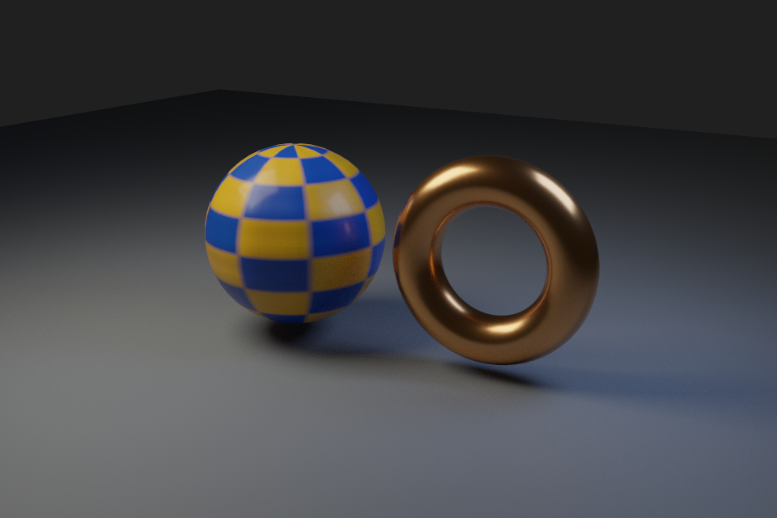
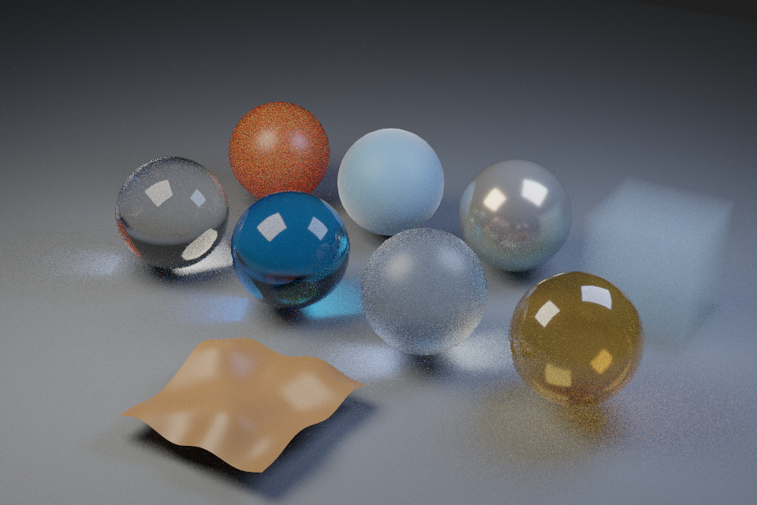
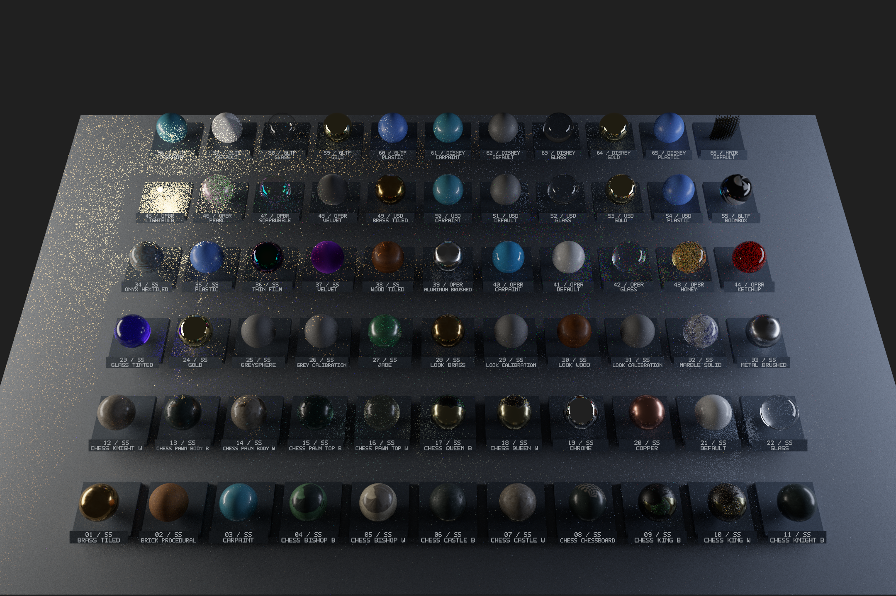
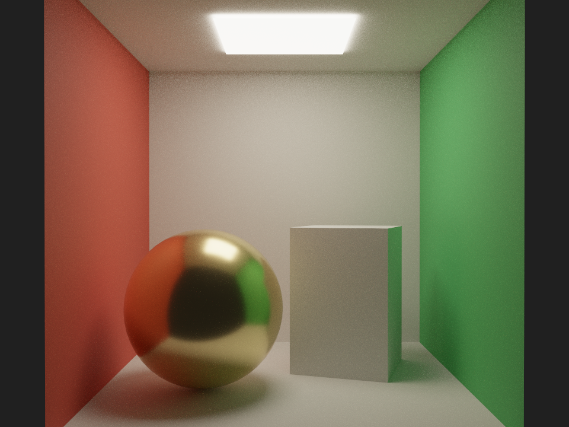
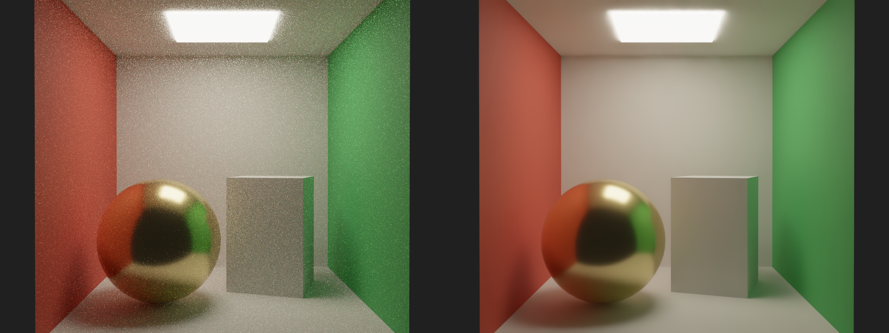
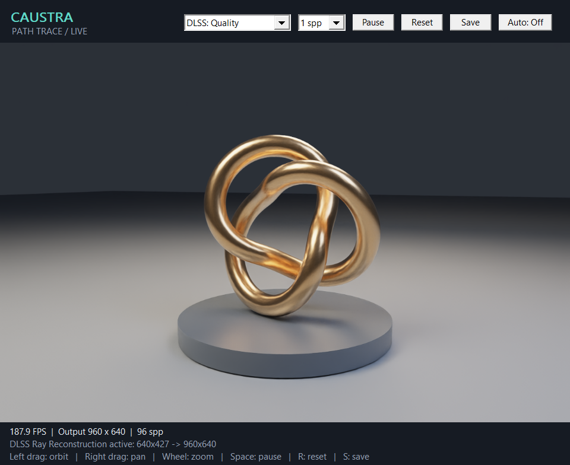

# Caustra：纯 Vulkan Path Tracer

基于本机 `vk_gltf_renderer` 的路径追踪实现与其使用的 NVIDIA `nvshaders` 拆分改造。提供独立 C++20 静态库、命令行出图、Windows 实时查看 Demo 和回归测试。原始工程保持原样；新工程不链接原工程或 `nvpro_core2`，运行时不需要任何模型文件。

保留 Vulkan Ray Query 硬件求交、每个网格的 BLAS、实例 TLAS、三角形面积光、NEE、多重重要性采样、Russian Roulette、渐进累积和线性 HDR 回读；提供可选的 NVIDIA DLSS Ray Reconstruction 降噪与升采样。材质以 MaterialX 图为主要资产路径，支持六类原生表面模型、纹理、法线贴图、各向异性、清漆、折射透射、SSS、薄膜、fuzz、均匀参与介质与空间 SSS 网格。位移在外围工具中生成真实细分几何。Blender USD 导入与 MaterialX 编译位于独立资产工具层，核心不依赖 USD、MaterialX SDK、Python 或模型加载器。没有场景编辑器、光栅化、动画系统、复杂天空或 OptiX/OIDN。

## Blender / MaterialX 资产

在 Blender 的 USD 导出面板启用 **Materials → MaterialX Network**、纹理导出和网格三角化。Blender 4.5 LTS 的 Principled BSDF 会导出为 MaterialX **OpenPBR** 节点；工程提供独立的 OpenPBR 表面实现，保留材质图的逐命中求值。工程中附带由 Blender 4.5.3 实际导出的测试资产及重建脚本。

资产工具需要 Python 3.11–3.14。首次配置后，编译并查看模型：

```powershell
python -m venv build/asset-tools-env
./build/asset-tools-env/Scripts/python.exe -m pip install -r requirements-assets.txt
./build/asset-tools-env/Scripts/python.exe tools/compile_asset.py tests/assets/blender/scene.usdc renders/blender.caustra
cmake --preset windows
cmake --build --preset windows-release
./build/bin/Release/caustra_viewer.exe --asset renders/blender.caustra
# 离线出图，同样使用资产内的相机
./build/bin/Release/caustra_demo.exe --asset renders/blender.caustra --width 960 --height 640 --samples 128 --output renders/blender --validation --self-test
```



上图由随附的 Blender 资产实际渲染：960×640、1024 spp，未启用 DLSS。

资产编译器读取 USD 中的 `mtlx` 网络，重建并校验 MaterialX Document，使用真实 NodeDef 默认值，将受支持的节点图编译成 GPU 材质程序；不把连接的图压成常量 PBR 参数。自包含 `.caustra` 包含几何、材质指令和线性纹理数据，编译后可脱离源 USD、图片及 Python 环境运行。`caustra::assets` 是可选的 C++ 资产包读取库；`-DCAUSTRA_BUILD_ASSETS=OFF` 可关闭。

已支持多材质绑定、UV/法线插值、实例变换、Y/Z 向上与米制转换、透视相机、矩形/圆盘区域灯；材质支持基础色、金属度、粗糙度、IOR、各向异性方向、清漆及独立法线、发光和覆盖率。节点包含图像、常用算术/混合/向量运算、棋盘格与 MaterialX 标量/向量 Perlin 噪声。完整支持范围、颜色空间和纹理过滤约定见 [资产工具文档](tools/caustra_assets/README.md) 与 [架构说明](docs/architecture.md)。

### 完整特性测试场景

新增的 [Blender 场景及配套 MaterialX 文件](tests/assets/features/) 包含透明玻璃、吸收着色玻璃、磨砂玻璃、薄壁透射、SSS 蜡材质、OpenPBR fuzz、薄膜干涉、体积散射及程序位移网格。可编辑源文件为 `tests/assets/features/scene.blend`，重建脚本为 `tools/blender_export_features.py`。Blender 4.5 未导出的薄壁标记、体积和位移终端由可重现的 USD 附加层提供，原始 Blender 导出保持独立。

```powershell
./build/asset-tools-env/Scripts/python.exe tools/compile_asset.py tests/assets/features/scene.usda renders/features.caustra
./build/bin/Release/caustra_viewer.exe --asset renders/features.caustra --bounces 24
# 玻璃和多次散射需要更多路径深度
./build/bin/Release/caustra_demo.exe --asset renders/features.caustra --width 960 --height 640 --samples 256 --bounces 24 --output renders/features --validation --self-test
```



上图由该测试场景实际渲染：960×640、256 spp、24 次散射深度，未启用 DLSS。

透射支持粗糙折射、全内反射、薄壁与 RGB 色散；内部使用距离相关的 Beer–Lambert 吸收。SSS 通过内部自由程采样和相函数随机游走实现。体积支持均匀吸收、散射、发光与 Henyey–Greenstein 各向异性，最多 16 层嵌套；介质边界需要闭合且朝外，体积之间应嵌套或分离。薄膜使用 MaterialX 光谱积分近似，OpenPBR fuzz 使用其 Zeltner 模型。标量/向量位移在资产编译时细分并改变顶点和法线，`--displacement-subdivisions` 控制细分等级。

## MaterialX 官方示例全材质画廊

基于官方 **MaterialX v1.39.5**，将 50 个示例文件中的 **62 个独立材质与 4 个 Look 复用样本，共 66 个样本**放在同一场景，包括棋盘示例的全部 15 个材质。模型、毛发薄带、展台、名称标签、灯光与相机均由程序生成，支持旋转、平移和缩放查看。

```powershell
.\build\asset-tools-env\Scripts\python.exe tools/fetch_materialx_examples.py
.\build\asset-tools-env\Scripts\python.exe tools/build_materialx_gallery.py --source-root build/deps/materialx-official/MaterialX-1.39.5 --output renders/materialx_official
.\build\bin\Release\caustra_viewer.exe --asset renders/materialx_official.caustra --bounces 24
```



上图为实际渲染：2160×1440、256 spp、24 次散射，未启用 DLSS。六类模型为 Standard Surface、OpenPBR、glTF PBR、USD Preview Surface、Disney Principled 与 Simple Hair，按各自的原生图求值。生成器保留材质图，同时输出可编辑 USD、原始纹理副本和完整覆盖清单；任何未支持的活动节点都会使构建失败。默认运行包纹理最长边为 512，USD 保留原分辨率；空间 SSS 使用 32³ 网格离散近似。重建、精度约定与测试说明见 [官方画廊文档](docs/materialx_gallery.md)。

## 渲染效果

以下图片均由本工程在 NVIDIA GeForce RTX 5060 上实际渲染，场景由代码生成。

Cornell Box：960×720、2048 samples per pixel、最多 8 次散射，包含金属球、漫反射箱体和三角形面积光。此图未使用 DLSS。



DLSS 原生分辨率对照：960×720、64 个 1 spp 时域帧、RR 预设 E。左侧为同一批样本的原始累积结果，右侧为 DLSS Ray Reconstruction 输出。



## 实时查看 Demo（Windows）

构建后运行：

```powershell
./build/bin/Release/caustra_viewer.exe
```

窗口中实时渲染程序生成的铜色环结模型、底座和开放式摄影棚，可从各方向旋转查看。默认每帧 1 spp，在支持的硬件上自动开启 DLSS Quality；不可用时状态栏会说明并使用原始 Path Trace。静止后继续渐进收敛，拖动时通过相机运动向量保留 DLSS 历史。模型、材质和窗口逻辑都在示例层，渲染库不依赖窗口系统或模型加载器。



| 操作 | 功能 |
| --- | --- |
| 左键拖动 | 围绕模型旋转视角 |
| 右键或中键拖动 | 平移观察目标 |
| 鼠标滚轮 | 缩放 |
| `R` / `Home` | 恢复初始视角并重置累积 |
| `Space` | 暂停 / 恢复渲染 |
| `A` | 自动旋转视角 |
| `D` | 切换 DLSS 开关 |
| `S` | 保存当前 PPM 与线性 HDR PFM 到 `renders/` |
| `Esc` | 关闭窗口 |

顶部控件可以选择 DLSS 模式、每次呈现的采样数，也可暂停、重置、保存和自动旋转。画面角落显示实际 FPS、输出尺寸、DLSS 内部追踪尺寸与当前视角累积样本数。输出与视口物理像素一一对应，不设隐藏像素上限；放大窗口会重建相应 Buffer 和 DLSS 图像。DLSS Quality/Balanced/Performance 使用较低的内部分辨率；希望原生尺寸降噪可选择 DLSS Native。初始化 DLSS 或改变分辨率时可能短暂等待；最小化后暂停 GPU 工作。官方画廊包默认使用最长边 512 的纹理，放大窗口不会恢复源纹理已缩掉的细节，可按画廊文档重建更高分辨率纹理包。

```powershell
# 明确指定模式；显式请求的 DLSS 不可用时会报错
./build/bin/Release/caustra_viewer.exe --dlss native --validation
# 连续旋转展示
./build/bin/Release/caustra_viewer.exe --auto-orbit --width 960 --height 640
# 自动交互验证：真实窗口消息驱动旋转、平移、缩放、尺寸变化和暂停/重置
./build/bin/Release/caustra_viewer.exe --dlss off --smoke-test --validation --screenshot renders/viewer.bmp
```

实时查看器目前使用 Win32/GDI，只在 Windows 构建。`-DCAUSTRA_BUILD_VIEWER=OFF` 可关闭这个目标；Linux 保留原有离线示例。可用 `-DCAUSTRA_VIEWER_TESTS=ON` 将需要桌面会话的窗口交互测试加入 CTest。

## 性能测量

`caustra_benchmark` 使用与查看器相同的场景、环绕相机和显示转换，每帧 1 spp，分别记录渲染/降噪、HDR 回读和色调转换的中位耗时，另报整帧 P95。默认剔除预热帧；这些是同步 API 的 CPU 墙钟时间，不含窗口绘制，也不是纯 GPU timestamp。

```powershell
./build/bin/Release/caustra_benchmark.exe --asset renders/features.caustra --width 960 --height 640 --bounces 24 --frames 12 --warmup 3 --dlss all
# 真实窗口自动旋转，结束后输出各阶段中位耗时和运行 FPS
./build/bin/Release/caustra_viewer.exe --asset renders/features.caustra --width 960 --height 640 --bounces 24 --dlss quality --auto-orbit --fps-limit 240 --frames 60
```

`--dlss all` 依次测 Off、Quality、Performance，需要可用的 DLSS；关闭 DLSS 的构建用 `--dlss off`。`--static` 测静态累积。`-DCAUSTRA_BUILD_BENCHMARK=OFF` 可关闭基准目标。当前优化包括默认切线图快速路径、GPU 本地资源、缓存回读、共享相机包含关系与预计算介质表；材质能力和路径深度保持原样。

本机 NVIDIA GeForce RTX 5060、Windows Release，使用上述固定旋转轨迹、960×640 输出、24 层深度、1 spp，剔除 3 帧预热后统计 12 帧中位数：

| 模式 | 优化前整帧耗时 | 优化后整帧耗时 | 提速 |
| --- | ---: | ---: | ---: |
| 原生 Path Trace，DLSS Off | 403.5 ms | 16.7 ms | 24.1× |
| DLSS Quality | 202.0 ms | 11.0 ms | 18.4× |
| DLSS Performance | 130.4 ms | 8.6 ms | 15.2× |

相同输出尺寸的 HDR 回读由约 32 ms 降到约 1–2 ms。真实窗口自动旋转、DLSS Quality、24 层深度的 60 帧运行约 75 FPS（测试时限帧 240；默认查看器限帧 60）。同一场景 256 spp 的渲染及写出时间由 97.5 秒降到 3.09 秒，均不含初始化。性能优化阶段的图像对照中，线性 HDR 相对 RMSE 约 0.0015%，8 位预览在 614400 个像素中仅 1 个像素有差异。完整 21 项回归及关闭 DLSS/资产/窗口的最小配置 6 项回归均通过，包括 Vulkan 同步验证、薄体积、介质边棱、变换后近边界散射点、实体玻璃/镜像/SSS 擦边及相机内部出口，以及默认分辨率下 512 帧静止和 2048 帧环绕 DLSS 窗口测试。

## 构建与运行

需要 CMake 3.24+、C++20 编译器、Vulkan SDK 1.2+、支持 `VK_KHR_ray_query` 与 `VK_KHR_acceleration_structure` 的显卡和驱动，以及能够生成 SPIR-V 的 Slang 编译器。当前 Windows 环境可直接复用原项目已下载的 Slang 与 DLSS SDK；也可以用 `-DCAUSTRA_SLANG_ROOT=...`、`-DCAUSTRA_SLANGC=...` 和 `-DCAUSTRA_DLSS_ROOT=...` 指定自己的 SDK。此工程配置时不会下载依赖。

在本目录的 PowerShell 中执行：

```powershell
cmake --preset windows
cmake --build --preset windows-release
ctest --preset windows-release
./build/bin/Release/caustra_demo.exe --samples 128 --output renders/cornell --validation --self-test
```

程序输出 `renders/cornell.ppm`（Reinhard + sRGB）与 `renders/cornell.pfm`（线性浮点 HDR）。SPIR-V 在构建时嵌入静态库，不需要 Slang DLL、原始仓库、模型资源或着色器文件。启用 DLSS 编译时，构建自动将 SDK 的 release 版 `nvngx_dlss.dll` 和 `nvngx_dlssd.dll` 复制到程序旁；运行时需要这些库与兼容的 NVIDIA 驱动。`--help` 查看示例参数。

Vulkan SDK 自动查找环境变量 `VULKAN_SDK`，Windows 也会查找 `C:/VulkanSDK`。自定义安装位置可传 `-DVulkan_ROOT=...`。Slang 自定义路径例如：

```powershell
cmake --preset windows -DCAUSTRA_SLANG_ROOT=C:/SDK/slang
```

Linux 提供 `linux` 配置及 `linux-release` 构建/测试预设，需要 Ninja；此轮交付仅实测 Windows。没有 Vulkan Validation Layer 时使用 `-DCAUSTRA_GPU_TESTS=OFF`，仍可手动运行 GPU 测试但不传 `--validation`。没有光追硬件时不能运行渲染，不提供 CPU 或光栅化回退。

## DLSS 降噪配置

DLSS 在构建时默认启用支持，运行时默认关闭。纯原生渲染构建可用 `cmake --preset windows -DCAUSTRA_ENABLE_DLSS=OFF`，不需要 NGX SDK 或 DLL。重新启用用 `-DCAUSTRA_ENABLE_DLSS=ON`；独立 SDK 路径用 `-DCAUSTRA_DLSS_ROOT=C:/SDK/DLSS`。显式请求 DLSS 而硬件、驱动、运行库不支持时会报错，避免把原始噪声图误认为降噪结果。

原生分辨率降噪示例：

```powershell
./build/bin/Release/caustra_demo.exe --width 960 --height 720 --samples 64 --dlss native --dlss-preset e --save-raw --output renders/dlss --validation --self-test
```

`--dlss` 接受 `off`、`native`、`quality`、`balanced`、`performance`。`native` 在输出分辨率做 RR；其他模式使用 NGX 查询的推荐内部分辨率，并降噪重建到 `--width` / `--height`。`--dlss-preset` 接受 `default`、`d`、`e`，对应本次接入 SDK 的 RR 模型预设。输出尺寸每边至少 32 像素。

DLSS 是时域降噪：每次采样提交一帧全新的 1 spp 噪声输入，`--samples 64` 在 DLSS 模式下代表 64 个时域帧。输入还包括法线/粗糙度、漫反射与高光反照率、线性深度、运动矢量和高光命中距离。DLSS 自己维护历史，原生路径的累积平均保留为独立输出。`--save-raw` 额外保存 `_raw.ppm` 与 `_raw.pfm`，其尺寸是实际内部分辨率。

库接口用 `setDlssSettings` 设置 `DlssSettings` 的开关、质量与模型预设；`dlssStatus` 返回当前状态。开启后 `readback` 返回降噪后的目标分辨率图，`readbackRaw` 返回内部原始累积图。设置失败保留此前可运行的配置。`setCamera` 表示相机切换，会重置累积和 DLSS 历史；连续移动时使用 `updateCamera`，它清空当前视角的原始累积，并通过当前/上一帧矩阵生成像素运动向量，保留 DLSS 历史。场景、分辨率和渲染配置变化仍完整重置。当前运动向量支持静态几何的相机移动；未来动态模型需要补充实例/顶点的上一帧变换。

当前开发用 NGX application ID 与原始示例一致，可通过 `CAUSTRA_DLSS_APPLICATION_ID` 覆盖。DLSS SDK 和运行库沿用 NVIDIA 自身的许可，不属于工程 Apache-2.0 代码。

## 接入自己的几何体与材质

公开 API 在 [include/caustra/renderer.hpp](include/caustra/renderer.hpp)。调用顺序：

```cpp
caustra::Renderer renderer;
renderer.setSettings(settings);
renderer.setScene(scene);       // 自己填充 vertices / indices / materials / instances
renderer.setCamera(camera);
renderer.render(64);            // 增加 64 samples per pixel
auto image = renderer.readback();
image.savePfm("result.pfm");
```

通过 `add_subdirectory` 引入此工程后链接 `caustra::caustra`。`examples/demo_scene.cpp` 演示如何构造三角网格、平滑法线、材质和实例变换；它属于示例，不属于渲染库。网格可以被多个实例共享。实例使用行主序 3×4 仿射矩阵，顶点索引属于各自网格。顶点位置以统一世界单位解释，颜色与发光均为线性 RGB。零法线会回退到三角形几何法线。

相机、场景或渲染设置变化会清空累积；连续调用 `render` 则续采样。`setScene` 是同步的完整场景上传，会重建 BLAS/TLAS，适合作为第一阶段明确的输入边界。后续增加动态更新或扩展材质节点时，参阅 [docs/architecture.md](docs/architecture.md)。

## 验证

CPU 测试检查非法索引、退化网格、矩阵、相机、材质程序、纹理、DLSS 配置、图像保存和环绕相机控制。GPU 测试覆盖解析材质图、纹理方向/寻址/mip、BSDF 能量与采样、图驱动自发光、透明覆盖率，以及原有渐进采样、运动历史与开关回归。配置资产 Python 后，CTest 还会重编译真实 Blender USD、读取资产并渲染。可用 `-DCAUSTRA_ASSET_PYTHON=...` 指定安装了 `requirements-assets.txt` 的 Python；这些依赖仅用于资产编译/测试。`--validation` 开启 Vulkan Validation Layer，错误会使测试失败。在 NVIDIA RTX 环境配置 `-DCAUSTRA_DLSS_GPU_TESTS=ON` 可将 DLSS 实际执行加入 CTest，并启用同步验证。

当前实现以清晰的核心接口和可运行性为优先：GPU 提交同步执行，静态资源与累积缓冲使用 GPU 本地内存，上传/回读通过 staging，回读优先 CPU 缓存内存，每次调用线程独占，不提供并发渲染。纹理存在线性浮点 mip atlas，使用显式射线足迹过滤；每材质最多 128 条图指令。示例按米级空间构建，射线偏移包含固定绝对项，暂不支持微米级场景或极端巨大坐标。非常高亮的自发光、小面积强光、玻璃焦散和高密度多次散射会增加采样方差；没有降噪时低采样图像有 Monte Carlo 噪声。粗糙度在着色时设有有限下限，暂不支持理想 delta 镜面或 HDR 环境贴图。空间变化的 SSS/透射内部系数使用 32³ 网格近似；资产编译器的显式 volume 终端仍限均匀系数。实体 IOR、色散和 thin-walled 状态须在体内均匀，实体边界须完全覆盖；薄壁透射可以使用空间变化的表面颜色。

许可证与改造来源见 [NOTICE](NOTICE) 和 [third_party/nvshaders/ORIGIN.md](third_party/nvshaders/ORIGIN.md)。
